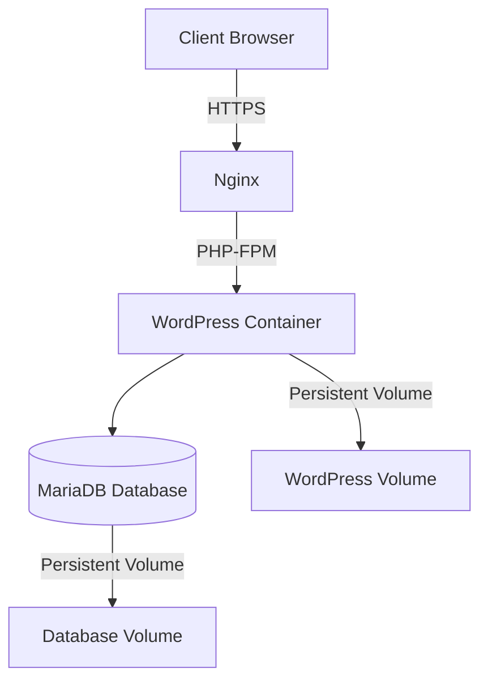

<h1 align="center">
	🛠️ Inception
</h1>

<p align="center">
	<b><i>Because virtual machines are not enough, we are going to use Docker</i></b>
</p>

<p align="center">
	<a href="#-about">About</a> •
	<a href="#-usage">Usage</a> •
	<a href="#-architecture">Architecture</a> •
	<a href="#-project-structure">Project Structure</a>
</p>

---
<p align="center">
	
	
	
</p>

---

## 💡 About

> _The **Inception** project consists of setting up a small infrastructure composed of different services under specific rules.  
> You will learn the basics of **system administration**, **Docker**, **docker-compose**, and how to containerize applications._  

Your infrastructure will include:

- ✅ **Nginx** configured with TLS/SSL  
- ✅ **WordPress** with **php-fpm**  
- ✅ **MariaDB** database  
- ✅ All services running in **separate Docker containers**  
- ✅ Managed through **docker-compose**  

---

## 🛠️ Usage

### ✅ Requirements
- **Docker** & **docker-compose** installed  
- Create a `.env` file with your configuration:

```
DOMAIN_NAME=yourdomain.com
MYSQL_ROOT_PASSWORD=your_root_password
MYSQL_USER=your_user
MYSQL_PASSWORD=your_password
MYSQL_DATABASE=wordpress
```

---

### ▶️ Build and Run

```shell
# Build and start containers in detached mode
$ make
```

---

### ⏹ Stop Services

```shell
# Stop containers
$ make down
```

---

### 🧹 Clean Everything

```shell
# Remove containers, images, volumes, networks
$ make fclean
```

---

### 🔍 Debug & Logs

```shell
$ docker-compose logs -f
$ docker ps
```

---

## 🖼️ Architecture



---

## 📂 Project Structure

```
inception/
├── Makefile
├── srcs/
│   ├── docker-compose.yml
│   ├── requirements/
│   │   ├── mariadb/
│   │   │   ├── Dockerfile
│   │   │   └── conf/
│   │   │       └── ...
│   │   ├── nginx/
│   │   │   ├── Dockerfile
│   │   │   └── conf/
│   │   │       └── nginx.conf
│   │   ├── wordpress/
│   │       ├── Dockerfile
│   │       └── tools/
│   │           └── setup.sh
│   └── .env
```

---

## ✅ Features

- 🔐 **SSL/TLS** with a self-signed certificate  
- 🐳 Containers built **from scratch (no prebuilt images)**  
- 🛡️ Isolated **Docker network**  
- 💾 Persistent **volumes** for data  

---

### 🔗 Useful Commands

```shell
# Check running containers
docker ps

# Access WordPress container
docker exec -it wordpress bash

# Access MariaDB container
docker exec -it mariadb mysql -u root -p
```
